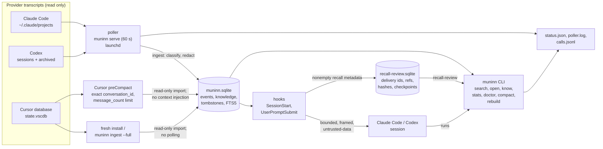

# Architecture

- **One transcript-store writer at a time.** The poller, `ingest`, `erase`, `compact`, `rebuild` and
  normalized knowledge writers take an exclusive lock on `writer.lock`: `fcntl.flock`. Readers open the database read-only. The journal mode is
  DELETE, so a crash leaves a journal that the next writer rolls back.
- **Recall review.** Nonempty generated recall blocks have sequential delivery ids.
  A separate private metadata database serializes counter and checkpoint updates in
  SQLite transactions, independently of the transcript-store writer lock. It records
  final source refs after shortening, request/session fingerprints and excerpt caps,
  never conversation text. Unavailable or busy audit storage preserves recall with
  an explicit uncounted-delivery warning. Every 50 recorded deliveries triggers a
  persistent review reminder; `recall-review` resolves requests and model assessments
  from the transcript index. Reviews open originals, distinguish model self-ratings
  from validated usefulness, and acknowledge completed batches explicitly.
- **Native poller.** macOS uses launchd. It runs `muninn serve --interval 60`.
- **Pinned release.** The service and provider hooks run the installed launcher,
  `~/.local/lib/muninn/current/bin/muninn`. It selects the interpreter from
  `$MUNINN_PYTHON`, then the installer's `python` link, then Python 3.13+ on PATH.
- **Provider detection (`install/provider_apps.py`).**
  - Gates: setup, config validation, installed-hook verification.
  - Evidence: installed desktop apps; never leftover configs/transcripts.
  - History import/existing index: independent.
- **Maintenance and publication.** Rebuild retains an actual maintenance owner
  across sequential writer regions and closes each SQLite connection before leaving
  its region. Fixed Git preparation runs outside the writer. Full source/key/intent
  fingerprints reject intervening changes; final replay, checks and publication
  remain inside one writer region. A private fenced-source archive is retained on
  success and failure. Publication is attempted once, with no automatic restore,
  orphan promotion or inferred admission reenable. Missing output is not proof of
  nonpublication. The final RW opener's own ctime normalization is the only local
  metadata exception; across-gap fingerprints remain strict.
- **Installer.** `install/installer.py` has the `--fresh` and `--upgrade` modes.
  Fresh preparation completes transcript and available Cursor history before it
  selects the release. Provider setup runs between writer regions with SQLite
  connections closed. A failed upgrade keeps the current data, runtime and
  configuration and leaves the service stopped. Cursor config rollback keeps
  foreign additions, edits, deletions and order. Uninstall keeps its own
  data-retention contract.
- **Cursor refresh.** The optional native `preCompact` hook imports only the
  uniquely matching `composerData:<conversation_id>`, scoped to valid native
  `workspace_roots`. A single root overrides stale process context; multiple roots
  prefer a matching payload `cwd`, then a matching `CURSOR_PROJECT_DIR` fallback.
  Missing, ambiguous or mismatched identity
  skips before writes. Bubble processing is capped at `message_count`, with one
  additional probe to detect oversize. Oversized
  conversations are skipped whole; full ingest remains the complete
  import path. The hook returns compact JSON, exits 0 on failure, and injects no
  context. Its 90-second deadline was measured on one host. It is not a
  completion guarantee on every machine.
- **Trust.** Stored content is untrusted historical data. Secrets receive best-effort
  redaction at ingest and on output; automatic injection is framed so pasted copies are
  flagged on ingest. See the README for the full list.
